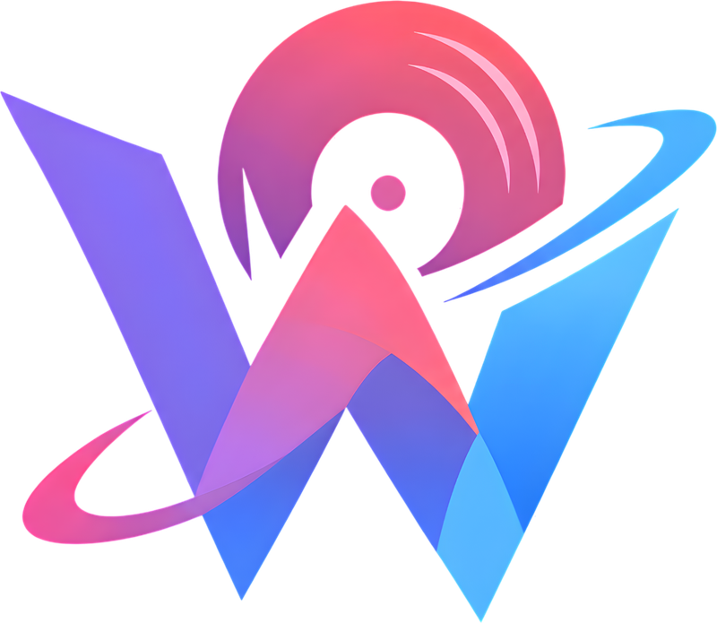
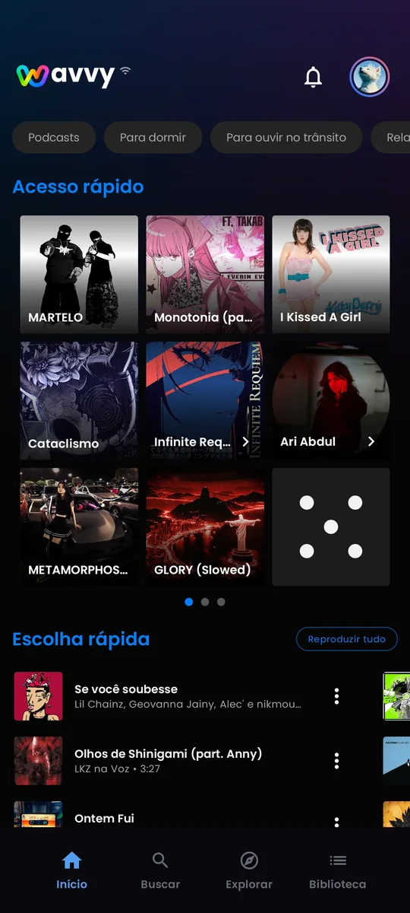
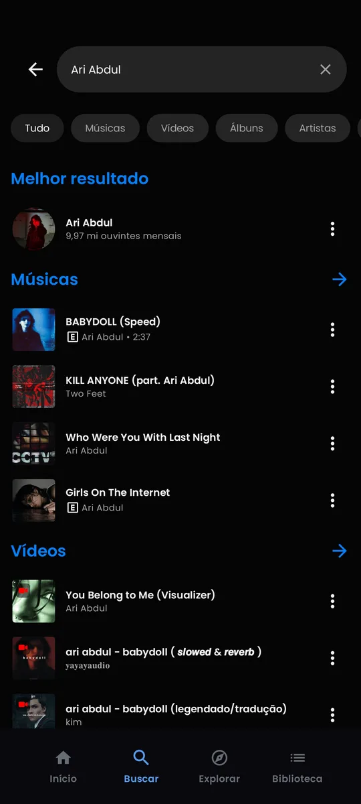
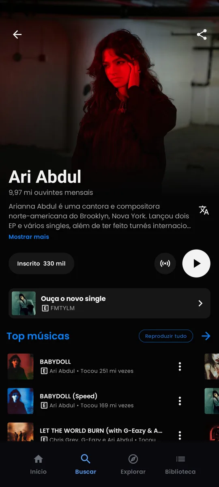
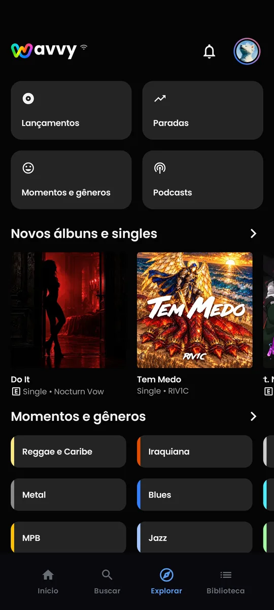
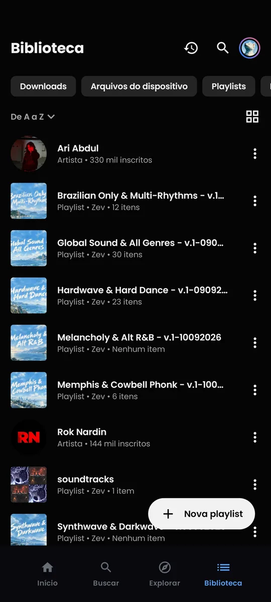
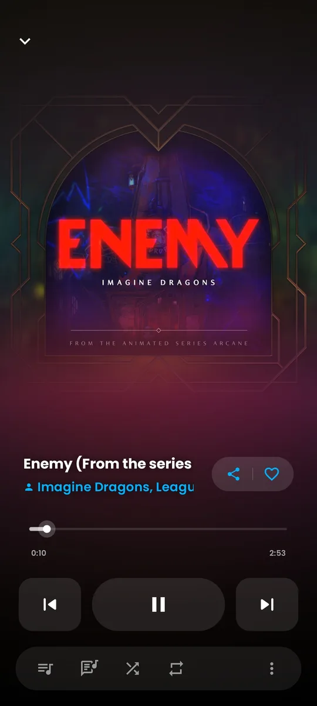
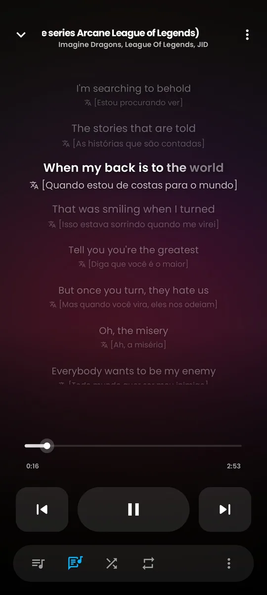
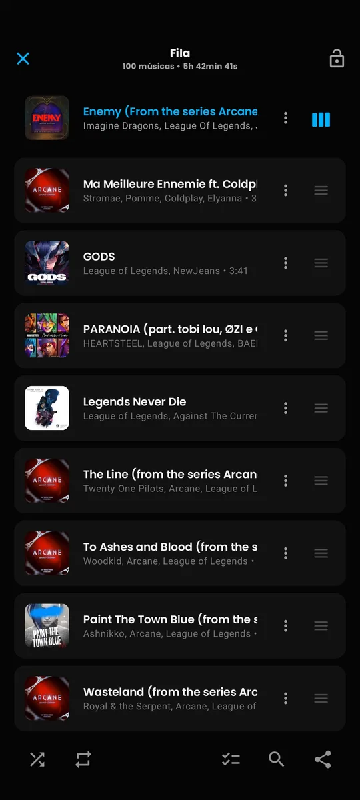
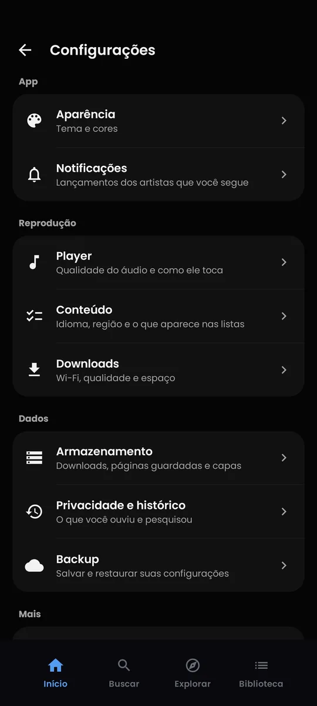

<div align="center">



# Wavvy

### Immersive YouTube Music client for Android, with online radio

<br/>

[](https://github.com/Zev-Kaapor/Wavvy/releases)
[](https://github.com/Zev-Kaapor/Wavvy/blob/main/LICENSE)
[](https://github.com/Zev-Kaapor/Wavvy)
[](https://github.com/Zev-Kaapor/Wavvy/releases)
[](#download-now)

<br/>

[](#status)
[](#download-now)
[](#features)
[](#translations)
[](#faq)
[](#support-the-project)

</div>

<details><summary><b>📋 Table of Contents</b></summary>

- [🧭 Overview](#overview)
- [🚧 Status](#status)
- [🖼️ Screenshots](#screenshots)
- [⚙️ Features](#features)
- [📥 Download Now](#download-now)
- [🛠️ Build](#build)
- [❓ FAQ](#faq)
- [🌍 Translations](#translations)
- [💖 Support the Project](#support-the-project)
- [✨ Special Thanks](#special-thanks)
- [📜 License](#license)
- [👥 Contributors](#contributors)
- [⚖️ Disclaimer](#disclaimer)

</details>

> [!WARNING]
> **Current Status** - Wavvy is being rebuilt from scratch 🚧, one small piece at a time. It already plays music with the player, the queue, the lyrics, the library, the downloads and the settings, but it is not complete: listening together, the integrations and the online radio are still coming. See the [Features](#features).
>
> **Regional Restriction** - If YouTube Music is unavailable in your region, this app won't work without a **VPN or proxy** connecting to a supported region.

> [!NOTE]
> **Your privacy** - Wavvy has no server of its own and does not track you. What you listened to, the songs you pinned and the lyrics you picked stay on your phone. The app only talks to the services it needs: YouTube Music for the songs, the lyrics services (the title and the artist are sent to find the lyrics), SponsorBlock when you turn it on (only the first letters of the code of the video are sent) and Google Translate when you translate the lyrics. More in the [FAQ](#faq).

---

<!-- OVERVIEW - Project overview -->
<div align="center">

<h1><a id="overview"></a>Overview</h1>
<em>Wavvy is an immersive YouTube Music client with online radio support, designed to be light, fluid and adaptive to any phone, for a premium listening experience.</em>

</div>

---

<!-- STATUS - Where the project is -->
<div align="center">

<h1><a id="status"></a>Status</h1>

</div>

Wavvy is being rebuilt from the ground up, one small piece at a time, so every screen can be reviewed and tuned before the next one starts. An earlier version of the app was the base of the design and is used as a reference for the rebuild.

<details>
<summary><b>📅 Progress by version</b> (every step of the rebuild, from the first version to the last)</summary>

<br>

| Step | State |
| :--- | :--- |
| **Project base** (build, signed releases, automated release workflow, logo and icon) | ✅ Done, version 0.0.1 |
| **Theme** (colors, typography, shapes and spacing for every screen size) | ✅ Done, version 0.1.0 |
| **Navigation** (bottom bar in portrait, side rail in landscape) | ✅ Done, version 0.1.0 |
| **Welcome and sign in** (optional, only brings the profile photo) | ✅ Done, version 0.1.0 |
| **Profile menu** (account, sign out and shortcuts) | ✅ Done, version 0.2.0 |
| **Player** (playback in the background, mini player, full player, queue and lyrics) | ✅ Done, version 0.3.0 |
| **Local history** (what you listened to, pinned songs and the lyrics you picked, all on the device) | ✅ Done, version 0.4.0 |
| **Search** (suggestions, filters, results by kind, a search history that follows your account and a list of searches you may like) | ✅ Done, version 0.5.0, suggestions in 0.8.0 |
| **Pages** (albums, playlists and artists, with the artist subscription, the full lists of releases and who the artist is) | ✅ Done, version 0.6.0 |
| **Home** (YouTube Music shelves, speed dial, recently played, quick picks and forgotten favorites) | ✅ Done, since version 0.7.0, it plays songs and opens the pages of albums, playlists and artists |
| **Notifications** (new releases of the artists you follow, in an Activity screen, on the bell and as a system notification) | ✅ Done, version 0.8.0 |
| **Explore** (the tab with its big buttons and the pages behind them: new releases, charts with a country picker, moods and genres, and podcasts) | ✅ Done, version 0.9.0 |
| **Podcasts** (the page of a podcast with its filters and search, and the page of an episode with its description) | ✅ Done, version 0.9.0, downloads and saving come later |
| **Playlists and likes** (save to a playlist from any menu, make, change and delete playlists with their cover, add songs, like songs) | ✅ Done, version 0.10.0 |
| **Library** (the saved playlists, podcasts, songs, albums and artists with their order, search and grid, the menus of each one and the downloads) | ✅ Done, version 0.11.0, with the files of the device in 0.17.0 |
| **Downloads** (songs and episodes kept in the app in the best quality, in folders, with their covers, played first and navigable without the internet) | ✅ Done, version 0.11.0, with the mark of the downloaded songs and the try again in 0.17.0 |
| **Settings** (player, downloads, content and language, proxy, storage, privacy, appearance, notifications, backup and about, with the history screen) | ✅ Done, since version 0.12.0, completed in 0.16.0 |
| **Updates** (looks at the releases of the app, downloads the file and installs it, with what changed in each one) | ✅ Done, version 0.12.0 |
| **Links** (links of YouTube and YouTube Music open in the app as a song, an album, a playlist, an artist or a podcast) | ✅ Done, version 0.13.0 |
| **Crossfade** (a song fades into the next one, with a choice of when and how long) | ✅ Done, version 0.14.0 |
| **Proxy** (HTTP and SOCKS, with login) | ✅ Done, version 0.14.0, with the sign in of Google in 0.18.0 |
| **SponsorBlock** (skips the parts that people marked, with their colors on the seekbar) | ✅ Done, version 0.15.0 |
| **Backup** (settings, library, history and more, in a file that ends in wvy locked with a password if you want, or kept by itself in your own Google Drive) | ✅ Done, version 0.16.0, with the Google Drive in 0.20.0 |
| **Device files** (the music of the phone, by song, artist or folder, with the delete of the files) | ✅ Done, version 0.17.0 |
| **Sleep timer** (stops the music after some minutes or at the end of the song) | ✅ Done, version 0.18.0 |
| **My profile** (the banner of your channel, a few words about you, your activity, the songs and artists you listened to the most and your playlists, each part can be kept private, with filters from today to the year) | ✅ Done, version 0.19.0, with the filter of today and the share in 0.20.0 |
| **Online radio** (stations from around the world) | 🔜 Planned |

</details>

---

<!-- SCREENSHOTS - Screenshots -->
<div align="center">

<h1><a id="screenshots"></a>Screenshots</h1>

<table>
  <tbody>
    <tr>
      <td align="center"><br><sub>Home</sub></td>
      <td align="center"><br><sub>Search</sub></td>
      <td align="center"><br><sub>Artist</sub></td>
    </tr>
    <tr>
      <td align="center"><br><sub>Explore</sub></td>
      <td align="center"><br><sub>Library</sub></td>
      <td align="center"><br><sub>Player</sub></td>
    </tr>
    <tr>
      <td align="center"><br><sub>Lyrics</sub></td>
      <td align="center"><br><sub>Queue</sub></td>
      <td align="center"><br><sub>Settings</sub></td>
    </tr>
  </tbody>
</table>

<p><em>Wavvy is still in development, so these screens show the current state and not the final version or the design it is going to have. The app is being refined, a piece at a time.</em></p>

</div>

---

<!-- FEATURES - Planned features -->
<div align="center">

<h1><a id="features"></a>Features</h1>

</div>

Open a group to see what is in it. ✅ is already in the app, 🚧 is being built and 🔜 is planned.

<details>
<summary><b>🔜 Planned</b> (what is coming next)</summary>

<br>

<table>
  <tr>
    <td width="50%" valign="top">

#### 👤 Social
- **Listen together**: listen to the same music with friends, at the same time

</td>
    <td width="50%" valign="top">

#### 🔌 Integrations
- **Discord**: show what you are listening to as an activity
- More services after that

</td>
  </tr>
  <tr>
    <td width="50%" valign="top">

#### 📻 Radio & Lives
- **Online radio**: stations from around the world, with a focus on Brazil
- **Lives**: live streams

</td>
    <td width="50%" valign="top"></td>
  </tr>
</table>

</details>

<details>
<summary><b>🚧 In progress</b> (what is being built now)</summary>

<br>

<table>
  <tr>
    <td width="50%" valign="top">

#### 🎨 Refinement
- The design and the animations are still being polished, screen by screen
- Fine tuning of the crossfade and of what the explicit filter covers

</td>
    <td width="50%" valign="top"></td>
  </tr>
</table>

</details>

<details>
<summary><b>✅ Complete</b> (what is already in the app)</summary>

<br>

<table>
  <tr>
    <td width="50%" valign="top">

#### 🎵 Playback
- Plays in the background, with a mini player, a full player and the media notification
- A queue that follows the radio of the song, with drag to reorder, swipe, search and selection of several songs
- Shuffle and repeat, also on the notification
- **Crossfade** between songs, from 250 milliseconds to 12 seconds, when you change the song and when a song ends
- **Sleep timer**, after some minutes or at the end of the song
- **SponsorBlock**, which skips the parts that people marked, with their colors on the seekbar

</td>
    <td width="50%" valign="top">

#### 📝 Lyrics
- Word by word, synchronized and plain lyrics from eight sources
- A manual search, translation, and options for the look and the order of the sources

</td>
  </tr>
  <tr>
    <td width="50%" valign="top">

#### 🧭 Discover
- Home with shelves, a speed dial with pins, quick picks and forgotten favorites
- Search with suggestions, filters by kind, a history that follows your account and searches you may like
- Explore: new releases, charts for every country, moods and genres
- Pages of albums, playlists and artists, with subscription, discography and who the artist is
- **Podcasts**: the page of a podcast with filters and search, and the page of an episode
- Notifications of new releases of the artists you follow

</td>
    <td width="50%" valign="top">

#### 📚 Library
- Playlists, podcasts, channels, songs, albums and artists with the orders of YouTube Music, search and grid
- Save to a playlist from any menu, make, change and delete playlists with their cover, and like songs
- **Device files**: the music of the phone by song, artist or folder, with the delete of the files
- Choose which lists made by YouTube Music the library shows

</td>
  </tr>
  <tr>
    <td width="50%" valign="top">

#### ⬇️ Downloads & Offline
- Songs, episodes, playlists, albums and podcasts in the best quality, kept in folders with their covers
- A downloaded song plays first, with a check mark, and a failed download tries again by itself
- The pages you opened stay, so you navigate them without the internet
- **Backup** in a file that ends in wvy, locked with a password if you want
- **Google Drive backup**, saved by itself every few hours in a private folder of the app in your own Drive, and put back when you change phones

</td>
    <td width="50%" valign="top">

#### 🔓 Account & Privacy
- Sign in is optional, and the app only keeps your name, your profile photo and the banner of your channel
- **My profile** with your activity, the songs and artists you listened to the most and your playlists, and a switch to keep each part private
- What you listen to goes to the history of your YouTube Music account, if you want
- Pause the history and the search history, and block screenshots
- A screen with everything you listened to, with filters by period
- Links of YouTube and YouTube Music open in the app

</td>
  </tr>
  <tr>
    <td width="50%" valign="top">

#### ⚙️ Settings & Content
- Settings for the player, the downloads, the content, the storage, the privacy, the theme, the notifications and the backup
- Country of the content, hide explicit songs and albums, hide Shorts, and the language of the app (Portuguese or English)
- **Proxy** HTTP or SOCKS, with login, for places where YouTube Music is blocked

</td>
    <td width="50%" valign="top">

#### 📱 App
- Immersive and minimalist design with fluid animations, powered by Material 3
- Layouts that adapt to every screen size, and a light APK
- Updates inside the app, with what changed in each version, which you can translate

</td>
  </tr>
</table>

</details>

<div align="center">

<br>

<em>Built with <b>Kotlin</b> and <b>Jetpack Compose</b> for a native Android experience that feels fast, responsive and beautiful.</em>

</div>

---

<!-- DOWNLOAD - Downloads -->
<div align="center">

<h1><a id="download-now"></a>Download Now</h1>

[](https://github.com/Zev-Kaapor/Wavvy/releases)

</div>

A new release with signed APKs is published on GitHub every time the app version changes. Pick the one that matches your phone:

| APK | When to use it |
| :--- | :--- |
| **universal** | Works on any device, larger file. Pick this one if unsure. |
| **arm64-v8a** | Most phones from 2017 onwards. |
| **armeabi-v7a** | Older 32-bit devices. |

While the version starts with `0.`, releases are marked as pre-releases.

Wavvy needs **Android 8.0 (API 26)** or newer. After the first install the app looks for new versions by itself, in **Settings → About → Versions**, as long as the first install also came from here, because an app built in Android Studio is signed with another key and cannot be replaced by a release.

---

<!-- BUILD - Build from source -->
<div align="center">

<h1><a id="build"></a>Build</h1>

</div>

To build Wavvy yourself you need **Android Studio** and **JDK 25**.

```bash
git clone https://github.com/Zev-Kaapor/Wavvy.git
cd Wavvy
./gradlew assembleDebug
```

The APK of the debug build is in `app/build/outputs/apk/debug/`. The releases are signed with the key of the project, which is kept in the secrets of the repository, so a build of yours does not update one of the releases and the other way around.

---

<!-- FAQ - Frequently asked questions -->
<div align="center">

<h1><a id="faq"></a>FAQ</h1>

> **Note:** As Wavvy is still in active development, this FAQ section is incomplete and will be updated as we progress. 🚀

</div>

<details>
  <summary><b>Is Wavvy free to use?</b></summary>
  <br>
  Yes, Wavvy is completely free and open-source. There are no premium subscriptions or hidden costs.
</details>

<details>
  <summary><b>Do I need a Google account?</b></summary>
  <br>
  No. You can use Wavvy without an account. Signing in is optional and will unlock your library, likes and personalized recommendations.
</details>

<details>
  <summary><b>Why do I need a VPN/Proxy in some regions?</b></summary>
  <br>
  Wavvy acts as a client for YouTube Music. If the service is restricted by Google in your country, our app inherits those same regional limitations.
</details>

<details>
  <summary><b>Is the app ready to use?</b></summary>
  <br>
  Not yet. Wavvy is being rebuilt from scratch, one piece at a time, and each screen arrives after being reviewed on a real phone. It already does a lot, with the Home, the search, the library, the downloads, the player, the lyrics and the settings, but listening together, the integrations and the online radio are still coming. See the <a href="#features">Features</a> section.
</details>

<details>
  <summary><b>Which APK should I download?</b></summary>
  <br>
  If you are not sure, take the <b>universal</b> one. Phones from 2017 onwards can use <b>arm64-v8a</b>, and older 32-bit devices need <b>armeabi-v7a</b>.
</details>

<details>
  <summary><b>Are the screenshots the final design?</b></summary>
  <br>
  No. Because I'm a bit stubborn and can't stop tweaking the UI (no, it's totally not OCD, *cough cough* :D), the screenshots show how the app is today, and not the version or the design it is going to have. Every screen is still being refined.
</details>

<details>
  <summary><b>Does it work without the internet?</b></summary>
  <br>
  Yes, in part. The songs you downloaded and the music of your phone play without the internet, and the pages you opened and your library stay available to navigate. Everything else needs the internet.
</details>

<details>
  <summary><b>What is a file that ends in wvy?</b></summary>
  <br>
  It is a backup made by Wavvy, with the settings, the library view, the history and more, as you chose. You can lock it with a password, and opening it from the files or from a message takes you to the import. Your playlists and likes are not in it, they stay in your YouTube Music account.
</details>

<details>
  <summary><b>Which Android versions does it support?</b></summary>
  <br>
  Android 8.0 (API 26) and newer.
</details>

<details>
  <summary><b>Where is the contributing document?</b></summary>
  <br>
  Currently, it only exists in my head! I will write down a proper guide once the project hits a more complete version and is ready for public collaboration.
</details>

<details>
  <summary><b>Does Wavvy collect my personal data?</b></summary>
  <br>
  No, Wavvy has no server of its own and does not track you. What you listened to, the songs you pinned and the lyrics you picked are kept <b>only on your device</b>, to build the sections of the Home, and never leave it, unless you turn on the backup in your own Google Drive, which keeps a copy in a private folder of the app in your account. Like any client of other services, the app does talk to them: YouTube Music for the songs, the lyrics services (the title and the artist of the song are sent so they can find the lyrics) and Google Translate when you turn the translation of the lyrics on (the text of the lyrics is sent to translate it). If you sign in with Google, only your name, your profile photo and the banner of your channel are kept. Read the full <a href="PRIVACY.md">Privacy Policy</a>.
</details>

<details>
  <summary><b>Can I import my playlists from other services?</b></summary>
  <br>
  We are working on bringing more synchronization features in future updates. Stay tuned!
</details>

<div align="center">

<h3>More questions? <a href="https://github.com/Zev-Kaapor/Wavvy/issues">Open an issue on GitHub!</a></h3>

</div>

---

<!-- TRANSLATIONS - Translations -->
<div align="center">

<h1><a id="translations"></a>Translations</h1>

<h3>Help us bring Wavvy to more people! 🌍</h3>

<p align="center">
  Wavvy speaks <strong>Portuguese (Brazil)</strong> and <strong>English</strong> for now. If your device is set to Portuguese (Brazil) the app uses it, any other language falls back to English.
</p>

<p align="center">
  <strong>Weblate coming soon</strong> • <a href="https://github.com/Zev-Kaapor/Wavvy/issues/new">Open an issue to contribute</a>
</p>

</div>

---

<!-- SUPPORT - Support the project -->
<div align="center">

<h1><a id="support-the-project"></a>Support the Project</h1>

<h3>Wavvy is free and open-source. If the app brings joy to your life, consider supporting its development! ❤️</h3>


&nbsp; | &nbsp;


</div>

---

<!-- ACKNOWLEDGMENTS - Special thanks -->
<div align="center">

<h1><a id="special-thanks"></a>Special Thanks</h1>

<h3>Wavvy stands on the shoulders of incredible open-source work!</h3>

<h3>Projects and Inspirations</h3>

<table>
  <thead>
    <tr>
      <th></th>
      <th align="center">Project</th>
      <th align="center">Author</th>
      <th align="center">What it brought</th>
    </tr>
  </thead>
  <tbody>
    <tr>
      <td align="center"></td>
      <td><strong>Metrolist</strong></td>
      <td><a href="https://github.com/MetrolistGroup/Metrolist">MetrolistGroup</a></td>
      <td>The player, the way the audio is found and many ideas</td>
    </tr>
    <tr>
      <td align="center"></td>
      <td><strong>Morphe</strong></td>
      <td><a href="https://github.com/MorpheApp/morphe-patches">MorpheApp</a></td>
      <td>The crossfade and when it works, by VazerOG</td>
    </tr>
    <tr>
      <td align="center"></td>
      <td><strong>ReVanced</strong></td>
      <td><a href="https://revanced.app">ReVanced</a></td>
      <td>Inspiration for features such as SponsorBlock</td>
    </tr>
    <tr>
      <td align="center"></td>
      <td><strong>RiMusic</strong></td>
      <td><a href="https://github.com/fast4x/RiMusic">fast4x</a></td>
      <td>The one that came before RiPlay and inspired it</td>
    </tr>
    <tr>
      <td align="center"></td>
      <td><strong>RiPlay</strong></td>
      <td><a href="https://github.com/fast4x/RiPlay">fast4x</a></td>
      <td>Ideas for the downloads and the settings</td>
    </tr>
    <tr>
      <td align="center"></td>
      <td><strong>SimpMusic</strong></td>
      <td><a href="https://github.com/maxrave-dev/SimpMusic">maxrave-dev</a></td>
      <td>Where the notifications and the pages were studied</td>
    </tr>
    <tr>
      <td align="center"></td>
      <td><strong>SponsorBlock</strong></td>
      <td><a href="https://sponsor.ajay.app">Ajay Ramachandran and its community</a></td>
      <td>The marked parts that are skipped, under CC BY-NC-SA 4.0</td>
    </tr>
    <tr>
      <td align="center"></td>
      <td><strong>YouTube Music</strong></td>
      <td><a href="https://music.youtube.com">Google</a></td>
      <td>The look and the content that the app shows</td>
    </tr>
    <tr>
      <td colspan="4" align="center"><em>and more amazing open-source projects</em></td>
    </tr>
  </tbody>
</table>

<h3>Thanks to Google</h3>

<p>Thank you to Google, especially to <strong>YouTube Music</strong>, the service whose music Wavvy brings to a lighter and more fluid app, and to <strong>Gemini</strong>, whose colors inspired the look of Wavvy.<br>
<em>Wavvy is an independent project and is not affiliated with or endorsed by Google.</em></p>

<h3>Development Helpers</h3>

<table>
  <thead>
    <tr>
      <th></th>
      <th align="center">Person</th>
      <th align="center">What it brought</th>
    </tr>
  </thead>
  <tbody>
    <tr>
      <td align="center"></td>
      <td><strong>Noa Inazawa</strong></td>
      <td>Started the project and helped to set its course</td>
    </tr>
    <tr>
      <td align="center"></td>
      <td><strong>Walppxk</strong></td>
      <td>Beta Tester and QA Analyst</td>
    </tr>
  </tbody>
</table>

<h3>Helper Tools</h3>

<table>
  <thead>
    <tr>
      <th></th>
      <th align="center">Tool</th>
      <th align="center">What it brought</th>
    </tr>
  </thead>
  <tbody>
    <tr>
      <td align="center"></td>
      <td><a href="https://claude.com/claude-code"><strong>Claude Code</strong></a></td>
      <td>Development assistant and Tech Lead</td>
    </tr>
    <tr>
      <td align="center"></td>
      <td><a href="https://notebooklm.google.com"><strong>Gemini (NotebookLM)</strong></a></td>
      <td>Inspiration for the look and the identity of the app</td>
    </tr>
  </tbody>
</table>

<h3>Core Technologies</h3>

<table>
  <thead>
    <tr>
      <th align="center">Library/Tool</th>
      <th align="center">Contribution</th>
    </tr>
  </thead>
  <tbody>
    <tr>
      <td><strong>innertubex</strong> (MetrolistGroup)</td>
      <td>Finds the audio of each song, the core of the extraction engine</td>
    </tr>
    <tr>
      <td><strong>Media3 (ExoPlayer)</strong></td>
      <td>Playback in the background, the queue and the media notification</td>
    </tr>
    <tr>
      <td><strong>Jetpack Compose</strong></td>
      <td>Modern, fluid Android UI framework</td>
    </tr>
    <tr>
      <td><strong>Material Design 3</strong></td>
      <td>Design system and dynamic theming</td>
    </tr>
    <tr>
      <td><strong>Room, Ktor, OkHttp & Coil</strong></td>
      <td>Local history, network requests and image loading</td>
    </tr>
    <tr>
      <td><strong>MusicBrainz</strong></td>
      <td>Birth, origin, genres and links of the artists, an open database</td>
    </tr>
    <tr>
      <td><strong>Reorderable</strong> (Calvin-LL)</td>
      <td>Dragging the songs of the queue</td>
    </tr>
  </tbody>
</table>

<h3>Lyrics Services</h3>

<p>The lyrics come from <strong>BetterLyrics</strong>, <strong>Paxsenix</strong>, <strong>LyricsPlus</strong>, <strong>LrcLib</strong>, <strong>KuGou</strong>, <strong>Zemer</strong> and the lyrics and captions of <strong>YouTube Music</strong>, and the translation uses the public endpoint of <strong>Google Translate</strong>, as RiMusic does. Thank you to everyone who keeps them open!</p>

<h3>Thank you to the entire open-source community! Every library and tool that powers this project!</h3>

</div>

---

<!-- LICENSE - License -->
<div align="center">

<h1><a id="license"></a>License</h1>

</div>

Wavvy is licensed under the **GNU General Public License v3.0**, see the [LICENSE](LICENSE) file. The projects that inspire it are also GPL-3.0, and any code adapted from them keeps its credit.

---

<!-- CONTRIBUTORS - Contributors -->
<div align="center">

<h1><a id="contributors"></a>Contributors</h1>

<h3>This project wouldn't exist without these amazing people!</h3>

<a href="https://github.com/Zev-Kaapor/Wavvy/graphs/contributors">
  
</a>

<h5>Want to contribute? A contribution guide is coming soon, until then <a href="https://github.com/Zev-Kaapor/Wavvy/issues">open an issue</a>!</h5>

</div>

---

<!-- DISCLAIMER - Legal notice -->
<div align="center">

<h1><a id="disclaimer"></a>Disclaimer</h1>

Wavvy is an open-source, non-commercial project developed for educational and personal use. This project is **not affiliated with, funded, authorized, endorsed by, or associated** with YouTube, Google LLC, or any of their affiliates and subsidiaries.

All trademarks, service marks, and intellectual property rights referenced in this project belong to their respective owners. Wavvy does not host, store, or distribute any copyrighted media; it functions strictly as a client interface for publicly available content provided via third-party APIs.

</div>

---

<div align="center">

<br/>

**Made with 💙 by [Zev Kaapor](https://github.com/Zev-Kaapor)**

**Status: Rebuilding 🚧**

</div>
