<div align="center">

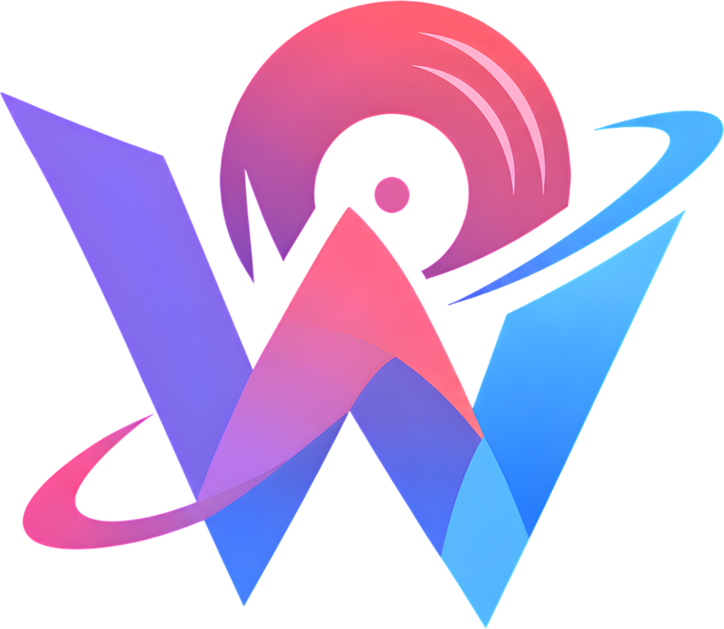

# Wavvy

### Immersive YouTube Music client for Android

<br/>

[](https://github.com/Zev-Kaapor/Wavvy/releases)
[](https://github.com/Zev-Kaapor/Wavvy/blob/main/LICENSE)
[](https://github.com/Zev-Kaapor/Wavvy)
[](https://github.com/Zev-Kaapor/Wavvy/releases)
[](#download-now)

<br/>

[](#status)
[](#download-now)
[](#features)
[](https://hosted.weblate.org/engage/wavvy/)
[](#faq)
[](#support-the-project)

</div>

<details><summary><b>📋 Table of Contents</b></summary>

- [🧭 Overview](#overview)
- [📅 Status](#status)
- [🖼️ Screenshots](#screenshots)
- [⚙️ Features](#features)
- [📥 Download Now](#download-now)
- [🛠️ Build](#build)
- [❓ FAQ](#faq)
- [🌍 Translations](#translations)
- [💖 Support the Project](#support-the-project)
- [✨ Special Thanks](#special-thanks)
- [📜 License](#license)
- [👥 Contributors](#contributors)
- [⚖️ Disclaimer](#disclaimer)

</details>

> [!WARNING]
> **Regional Restriction** - If YouTube Music is unavailable in your region, this app won't work without a **VPN or proxy** connecting to a supported region.

> [!NOTE]
> **Your privacy** - Wavvy has no server of its own besides a tiny relay for the rooms of listening together, and it does not track you. What you listened to, the songs you pinned and the lyrics you picked stay on your phone. The app only talks to the services it needs: YouTube Music for the songs, the lyrics services (the title and the artist are sent to find the lyrics), SponsorBlock when you turn it on (only the first letters of the code of the video are sent), Google Translate when the lyrics, the comments, the description of an artist or the notes of a version are translated, MusicBrainz to find who an artist is and the album and the genres of the songs you listened to (the names of the artist and of the song are sent), Last.fm and Discord only when you connect them, your own Google Drive only when you turn the backup on, Google Cast when you send the sound to a TV, GitHub to look for a new version and radios.com.br when you open the radios (the lists and the sound of the stations). The search by sound sends up to twelve seconds of what the microphone hears to YouTube Music, only when you ask for it. More in the [FAQ](#faq) and in the [privacy policy](PRIVACY.md).

---

<!-- OVERVIEW - Project overview -->
<div align="center">

<h1><a id="overview"></a>Overview</h1>
<em>Wavvy is a YouTube Music client for Android, designed to feel familiar, beautiful, light and adaptive to any phone.</em>

<br>

<p align="center">An open-source project made with care for the details of every screen, for the people who love to listen to music.</p>

</div>

---

<!-- STATUS - Where the project is -->
<div align="center">

<h1><a id="status"></a>Status</h1>

</div>

Wavvy grew one small piece at a time, with every screen reviewed and polished before the next one began, and an earlier version of the app as the base of its design. Version 1.0.0 is where it all comes together, the first complete release.

<details>
<summary><b>📅 Progress by version</b> • every step, from the first version to 1.0.0</summary>

<br>

| Step | State |
| :--- | :--- |
| **Project base:** build, signed releases, automated release workflow, logo and icon | ✅ Done, version 0.0.1 |
| **Theme:** colors, typography, shapes and spacing for every screen size | ✅ Done, version 0.1.0 |
| **Navigation:** bottom bar in portrait, side rail in landscape | ✅ Done, version 0.1.0 |
| **Welcome and sign in:** optional, only brings the profile photo | ✅ Done, version 0.1.0 |
| **Profile menu:** account, sign out and shortcuts | ✅ Done, version 0.2.0 |
| **Player:** playback in the background, mini player, full player, queue and lyrics | ✅ Done, version 0.3.0 |
| **Local history:** what you listened to, pinned songs and the lyrics you picked, all on the device | ✅ Done, version 0.4.0 |
| **Search:** suggestions, filters, results by kind, a search history that follows your account and a list of searches you may like | ✅ Done, version 0.5.0, suggestions in 0.8.0 |
| **Pages:** albums, playlists and artists, with the artist subscription, the full lists of releases and who the artist is | ✅ Done, version 0.6.0 |
| **Home:** YouTube Music shelves, speed dial, recently played, quick picks and forgotten favorites | ✅ Done, since version 0.7.0, it plays songs and opens the pages of albums, playlists and artists |
| **Notifications:** new releases of the artists you follow, in an Activity screen, on the bell and as a system notification | ✅ Done, version 0.8.0 |
| **Explore:** the tab with its big buttons and the pages behind them: new releases, charts with a country picker, moods and genres, and podcasts | ✅ Done, version 0.9.0 |
| **Podcasts:** the page of a podcast with its filters and search, and the page of an episode with its description | ✅ Done, version 0.9.0, downloads and saving come later |
| **Playlists and likes:** save to a playlist from any menu, make, change and delete playlists with their cover, add songs, like songs | ✅ Done, version 0.10.0 |
| **Library:** the saved playlists, podcasts, songs, albums and artists with their order, search and grid, the menus of each one and the downloads | ✅ Done, version 0.11.0, with the files of the device in 0.17.0 |
| **Downloads:** songs and episodes kept in the app in the best quality, in folders, with their covers, played first and navigable without the internet | ✅ Done, version 0.11.0, with the mark of the downloaded songs and the try again in 0.17.0 |
| **Settings:** player, downloads, content and language, proxy, storage, privacy, appearance, notifications, backup and about, with the history screen | ✅ Done, since version 0.12.0, completed in 0.16.0 |
| **Updates:** looks at the releases of the app, downloads the file and installs it, with what changed in each one | ✅ Done, version 0.12.0 |
| **Links:** links of YouTube and YouTube Music open in the app as a song, an album, a playlist, an artist or a podcast | ✅ Done, version 0.13.0 |
| **Crossfade:** a song fades into the next one, with a choice of when and how long | ✅ Done, version 0.14.0 |
| **Proxy:** HTTP and SOCKS, with login | ✅ Done, version 0.14.0, with the sign in of Google in 0.18.0 |
| **SponsorBlock:** skips the parts that people marked, with their colors on the seekbar | ✅ Done, version 0.15.0 |
| **Backup:** settings, library, history and more, in a file that ends in wvy locked with a password if you want, or kept by itself in your own Google Drive | ✅ Done, version 0.16.0, with the Google Drive in 0.20.0 |
| **Device files:** the music of the phone, by song, artist or folder, with the delete of the files | ✅ Done, version 0.17.0 |
| **Sleep timer:** stops the music after some minutes or at the end of the song, with a gradual fade out and an automatic schedule | ✅ Done, version 0.18.0, with the fade and the schedule in 0.23.0 |
| **My profile:** the banner of your channel, a few words about you, your activity, the songs and artists you listened to the most with how many times and for how long, and your playlists, each part can be kept private, with filters from today to the year and a pull to refresh | ✅ Done, version 0.19.0, with the filter of today and the share in 0.20.0, and the rankings by plays in 0.21.0 |
| **Listen together:** a room with a code, the host chooses the music and the guests follow it at the same time, asking the host to change it | ✅ Done, version 0.22.0 |
| **Playback options:** skip silence, audio normalization with its level, persistent queue, stop when removed from recents, pause when muted, resume on Bluetooth and keep the screen on | ✅ Done, version 0.23.0 |
| **Discord:** shows what you listen to as an activity on your profile, with the type, the status, the texts, the cover and two buttons, set up in Integrations after a warning of the risk | ✅ Done, version 0.24.0 |
| **Traditional radios:** the AM and FM stations and the web radios of radios.com.br, by country, state and city, with a search and the sound live in the mini player | ✅ Done, version 0.25.0 |
| **Cast:** send the sound to a TV with Google Cast, with a screen of its own on the TV, buttons that work on the TV and on the phone, and the queue, the repeat and the shuffle kept in sync | ✅ Done, version 0.26.0 |
| **Selection and filters:** mark several songs in a playlist, an album, the library, the downloads and the files of the phone, with the actions for them, filters and a search inside the page of a playlist or an album, and more in the menu of a song | ✅ Done, version 0.27.0 |
| **Version 1.0.0:** the first complete release, after going over every screen from the start to the end, to polish what was not right and to make the app lighter and smoother<br><br>**New**<br>• The retrospective of the year, a story of pages with its own music, podiums, charts and a kind of listener for each person, on the profile in December and January and announced on the first of December<br>• The search by sound, in the app and from a tile of the quick settings that listens over any app, and the search by voice<br>• Last.fm, with the song that plays now and the listenings kept until the network is back<br>• 68 languages, with the lyrics, the comments and the notes of a version translated into them<br>• The comments of albums and songs, with their replies, their translation, the times that jump the song and the profile of who wrote them<br>• The page of a person who is not an artist, the history of your YouTube Music account brought in and a bell for the releases of each artist<br>• The audio quality for playing and for downloading, the choice of what SponsorBlock skips and how many taps of the previous button start the song again<br>• The credits of a song, the "not interested", more orders and new covers in the library and songs taken out of the library for good<br><br>**Pages and screens redrawn**<br>• The pages of an album, a playlist, a podcast and an episode<br>• The new releases, the charts with a podium, the moods and genres and the page of a genre<br>• The radios, with the station that plays, the favorites, the genres, the places, the capitals and all the countries<br>• The open player lying down as one screen, with the queue and the lyrics beside the song, and every screen keeping away from the camera<br>• Every menu and sheet as rounded cards, standing and lying down<br>• The notices as an island at the top, the welcome and the sign in in one screen, the profile as a banner taken from your channel and filters that slide to their place<br><br>**Cast**<br>• A new screen on the TV copied from the open player of the app<br>• The volume keys of the phone change the volume of the TV<br><br>**Fixed and tuned**<br>• A new order each time the shuffle is turned on, and a queue that no longer drops frames when the shuffle is pressed many times<br>• The data loading in every language, and only the countries that YouTube Music answers for in the country of the content<br>• A more natural crossfade and "Unknown artist" for the files of the phone that have none<br>• Many small details of every screen | ✅ Done, version 1.0.0 |

</details>

---

<!-- SCREENSHOTS - Screenshots -->
<div align="center">

<h1><a id="screenshots"></a>Screenshots</h1>

<table>
  <tbody>
    <tr>
      <td align="center">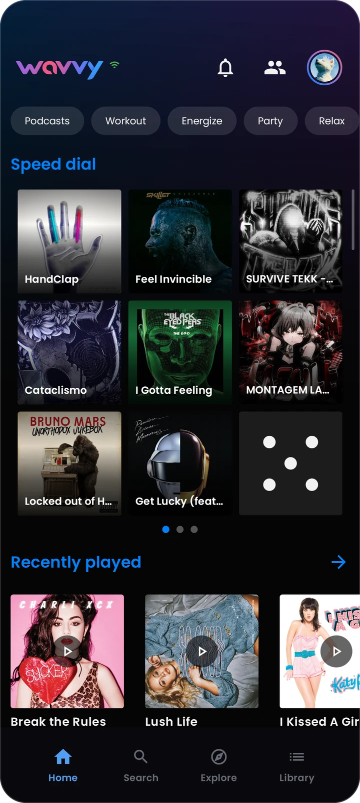<br><sub>Home</sub></td>
      <td align="center">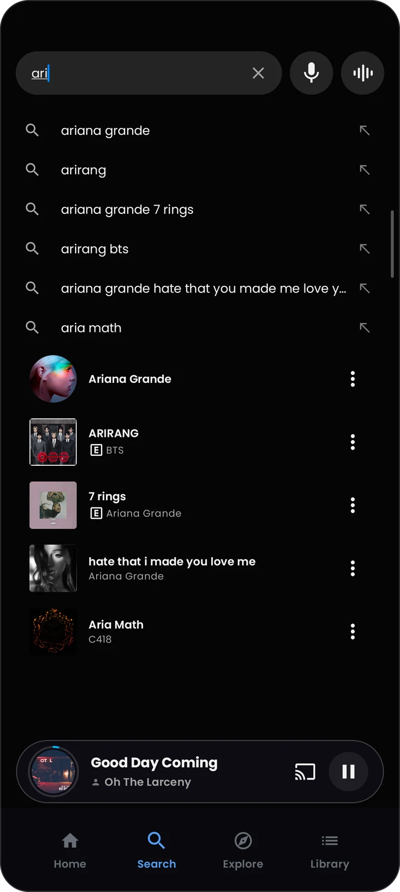<br><sub>Search</sub></td>
      <td align="center">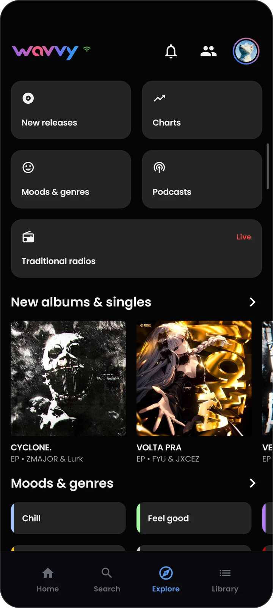<br><sub>Explore</sub></td>
      <td align="center">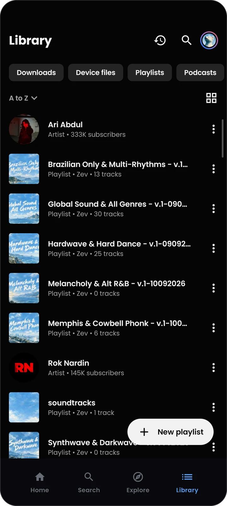<br><sub>Library</sub></td>
    </tr>
    <tr>
      <td align="center">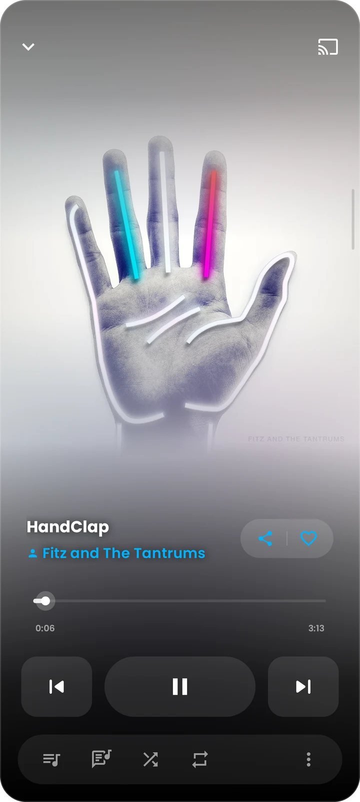<br><sub>Player</sub></td>
      <td align="center">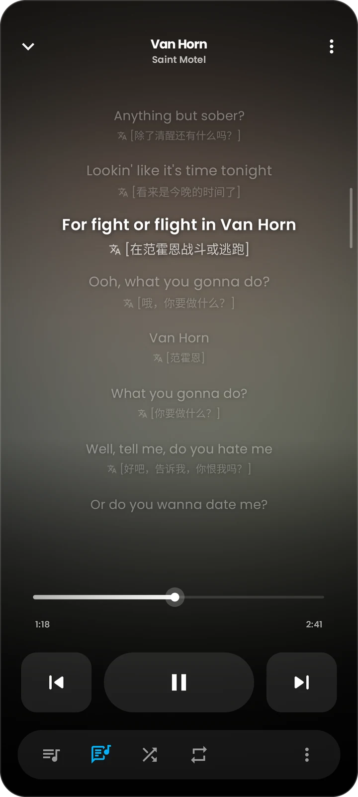<br><sub>Lyrics</sub></td>
      <td align="center">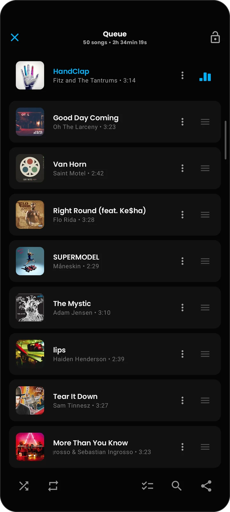<br><sub>Queue</sub></td>
      <td align="center">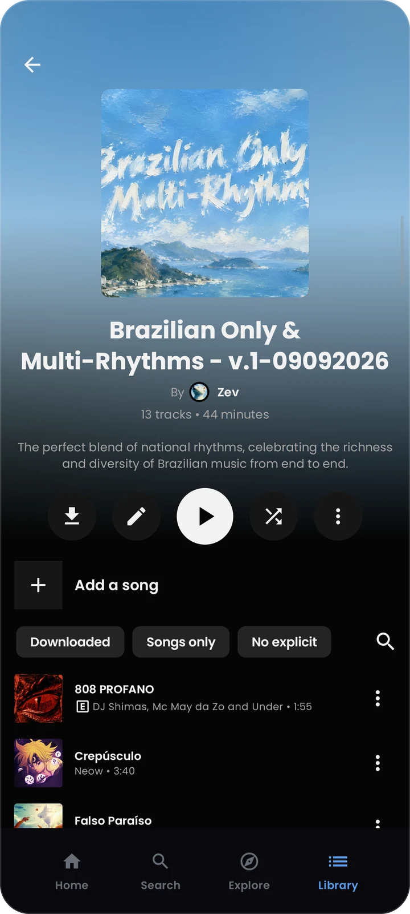<br><sub>Playlist</sub></td>
    </tr>
    <tr>
      <td align="center">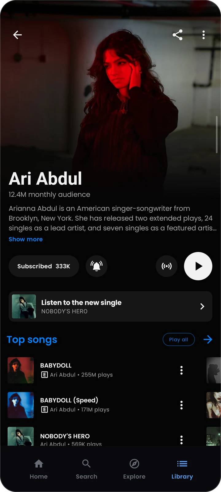<br><sub>Artist</sub></td>
      <td align="center">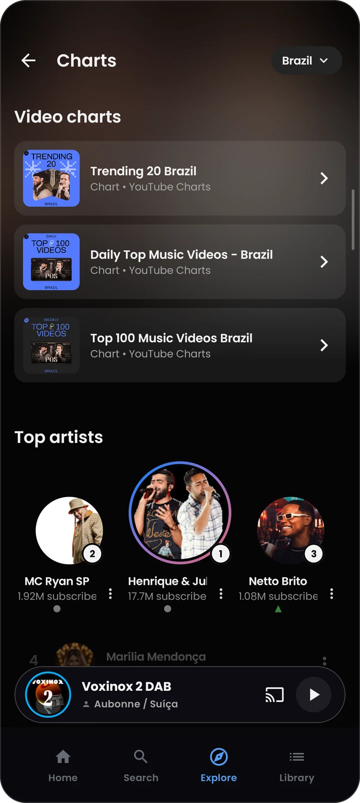<br><sub>Charts</sub></td>
      <td align="center">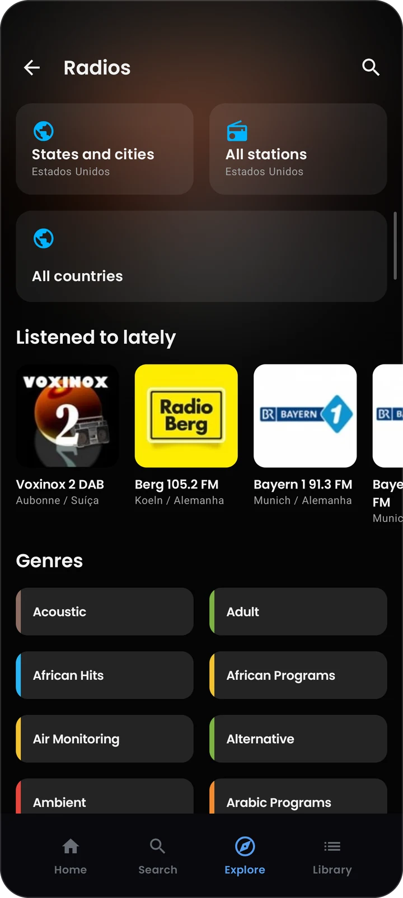<br><sub>Radios</sub></td>
      <td align="center">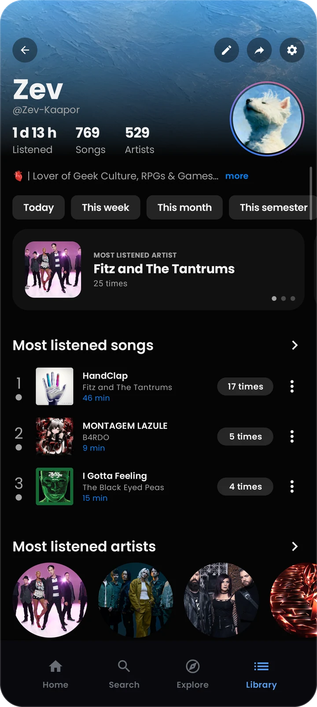<br><sub>My profile</sub></td>
    </tr>
  </tbody>
</table>

<p><b>More <a href="SCREENSHOTS.md">screenshots</a> here.</b></p>

</div>

---

<!-- FEATURES - What the app does -->
<div align="center">

<h1><a id="features"></a>Features</h1>

</div>

Everything Wavvy does, in groups you can open. ✅ is already in the app, 🚧 is being built and 🔜 is planned.

<details>
<summary><b>🔜 Planned</b> (what comes next)</summary>

<br>

Nothing is planned for now. Do you have an idea? [Open an issue](https://github.com/Zev-Kaapor/Wavvy/issues/new) and tell it.

</details>

<details>
<summary><b>🚧 In progress</b> (what is being built)</summary>

<br>

Nothing is being built right now, everything that was planned is already in the app.

</details>

<details>
<summary><b>✅ Complete</b> (everything the app does today)</summary>

<br>

<table>
  <tr>
    <td width="50%" valign="top">

#### 🎵 Playback
- Plays in the background, with a mini player, a full player and the media notification
- A queue that follows the radio of the song, filled again from the last one, with drag to reorder, lock, search, swipe and the selection of several songs
- The menu of a song: start a mix, play next, add to the queue, go to its album or its artist (and pick one when it has more than one), the credits, share, pin to the speed dial and "not interested"
- Shuffle and repeat, also on the notification, with a new order each time the shuffle is turned on
- **Crossfade** between songs, from 250 milliseconds to 12 seconds, when you change the song and when a song ends
- **Sleep timer**, after some minutes or at the end of the song, with a gradual fade out and an automatic timer for the hours you choose
- **Skip silence** and **audio normalization** with four levels, which bring the songs to a similar volume
- **Audio quality** for playing and for downloading: high (Opus, about 150 kbps, the best YouTube Music offers), medium, low or automatic, high on Wi-Fi and low on mobile data
- **Persistent queue**: the queue, the song and the place in it come back when you open the app, and the playback can stop when the app is closed from the recents
- Pause when the sound is turned off, resume when a Bluetooth device connects, and keep the screen on while the player is open
- Choose how many taps of the previous button start the song again before it goes back to the one before
- **SponsorBlock**, which skips the parts that people marked, with their colors on the seekbar, and you choose which kinds to skip
- The open player lying down as one screen, with the queue and the lyrics beside the song

#### 📝 Lyrics
- Word by word, synchronized and plain lyrics from seven sources, asked together: the first answer shows at once and a better kind takes its place
- **Translation** of the lyrics into the languages of the app, shown under each line
- Options for the mode, the alignment, the size of the text and the word by word, and the sources can be turned off and put in the order you prefer
- A search by hand, with every result of every source and the line that is sung now
- The lyrics you pick by hand are kept for the song

#### 🧭 Discover
- Home with shelves, mixes, quick picks, forgotten favorites, a speed dial with pins, the songs played lately, filters by mood and an arrow that opens each shelf
- Search with suggestions, a history that follows your account, searches you may like, the best result and filters by kind: songs, videos, albums, artists, playlists, episodes, podcasts and profiles
- **Search by voice** and **search by sound**, which finds a song that is played, sung or hummed, in the app and from a tile of the quick settings that listens over any app
- **Explore**: new releases, charts of every country with a podium, moods and genres with a page for each one, podcasts and the traditional radios
- Links of YouTube and YouTube Music open in the app

#### 🎤 Albums, artists and podcasts
- **Artists**: subscription, a bell for the new releases, popular songs, albums, singles, videos, who the artist is (when it was born or formed, the genres and the links) and the description in your language
- **Albums and playlists** with the artist and the numbers, play, shuffle, download, save to the library, a search and filters inside the page (downloaded, songs only, no explicit) and the orders that fit each one
- **Comments** of albums and songs to read, by the top or the newest, with the replies, the translation, the times that jump the song and the page of who wrote them
- **Podcasts**: the page of a podcast with filters and search, the page of an episode, more from the same podcast, the countdown of an episode that is not out, episodes for later and automatic downloads of the newest ones
- The page of a person who is not an artist, laid out as a profile

#### 📚 Library
- Playlists, podcasts, channels, songs, albums and artists with the orders that fit each list, a search, rows or covers, and the menu of each one
- Save to a playlist from any menu or from the selection of the queue, make, change and delete playlists with their cover, add songs and like songs, with an option to save several songs mirrored from the queue
- **Selection of several songs** in the pages of playlists and albums, the library, the downloads and the files of the phone, to play them next, add them to the queue, save them to a playlist, download them, take them out of a playlist or of the phone
- Save an album or a playlist to the library from its menu, take a song out of the library for good, and choose which lists made by YouTube Music the library shows
- **Device files**: the music of the phone by song, artist or folder, with the delete of the files, and "Unknown artist" for the ones that have none

#### ⬇️ Downloads and offline
- Songs, episodes, playlists, albums and podcasts in the quality you choose, kept in folders with their covers
- A downloaded song plays first, with a check mark, and a failed download tries again by itself
- Download only on Wi-Fi, a space limit from 1 to 20 GB, long episodes downloaded in pieces and automatic downloads of the newest episodes of a podcast
- The pages you opened stay, so you navigate them without the internet
- A screen of the storage with what takes the space and the ways to clear the saved pages, the covers and every download

</td>
    <td width="50%" valign="top">

#### 👤 Profile, history and retrospective
- **My profile**: the banner, the photo and the words of your channel, the time you listened, your songs and artists, the ones you listened to the most with how many times and for how long, your playlists, filters from today to the year, a share, and a switch to keep each part private
- The page of the profile of other people, laid out in the same way
- A screen with everything you listened to, by day, with filters by period and a way to take the songs out one by one
- What you listen to goes to the history of your YouTube Music account if you want, and the history of the account can be brought in
- **Retrospective of the year**: a story of pages with its own music, podiums, charts and a kind of listener for each person, on the profile in December and January, with a playlist of your year

#### 🔓 Account and privacy
- Sign in is optional, and the app only keeps your name, your profile photo and the banner of your channel
- Pause the listening history and the search history, and block screenshots
- No ads, no analytics and no account of its own, see the [privacy policy](PRIVACY.md)

#### 👥 Listen together
- A room with a code of six letters, made with one tap, where everyone hears the same song at the same time, each phone plays it by itself
- The host chooses the music, and the guests ask to play, pause, skip, change the place or add a song, which the host accepts or declines, or does by itself if it wants
- The connection comes back by itself when the signal drops, and the room can be shared with a code
- A small relay in [`server`](server) that runs for free on Cloudflare and never touches the audio

#### 📻 Traditional radios
- The stations of [radios.com.br](https://www.radios.com.br), the AM and FM ones and the web radios, with their logos
- A page with the station that plays, your favorites, the ones you listened to lately and the genres
- Walk through the countries, the states, the cities and the capitals, each one with a search that narrows its list, and a search by name, city, state or country
- The sound plays live in the mini player, which stays a pill, with no queue, no lyrics and no skip buttons, and the notification only plays and pauses
- Stations that use HLS and stations on plain HTTP both play

#### 📺 Cast
- Send the sound to a TV or speaker with Google Cast, from a button on the mini player and on the open player, with a list of devices you can search again
- The TV shows a screen of its own, like the open player lying down: the cover, the name in bold, the artist, the bar with its time and the controls, over the color of the cover
- Walk over the buttons and the bar with the remote of the TV, and jump ten seconds at a time, faster while the key is held
- Previous, next, play, pause, repeat and shuffle work on the TV and on the phone, which keep the same queue, and the volume keys of the phone change the volume of the TV
- The TV is left when you close the app or the mini player, and the songs of the phone and the radios keep playing on the phone

#### 🔌 Integrations
- **Discord**: show what you are listening to as an activity, off until you connect it and say you accept the risk, with the type, the status, the texts, the cover and two buttons you choose
- **Last.fm**: send what you listen to after half of the song or four minutes, and the song that plays now, and choose what is sent, with a queue that keeps the listenings until the network is back
- The login goes through your browser or the page of the service, the keys stay on your phone and you can disconnect in the same screen

#### 💾 Backup
- A file that ends in wvy, locked with a password if you want, with what you choose: the settings, the library, the history, the pinned songs, the lyrics you picked and the searches
- **Google Drive backup**, saved by itself on Wi-Fi when something changes, from every 2 hours to once a day, in a private folder of the app in your own Drive, and put back when you change phones

#### ⚙️ Settings and content
- Settings for the player, the downloads, the content, the storage, the privacy, the theme, the notifications and the backup
- The language of the app in **68 languages**, the country of the content, hide explicit songs and albums, hide Shorts, and show or hide videos (the choice also goes to your YouTube Music account, so the songs come back as music)
- Light or dark theme, or the one of the device, and the tab the app opens on
- **Proxy** HTTP or SOCKS, with login, for places where YouTube Music is blocked

#### 🔔 Notifications and updates
- A notice of the new releases of the artists you follow, in an Activity screen, on the bell and as a system notification, with how often to look
- Updates inside the app: it looks for a new version every time it opens and every few hours, tells you with a notification, downloads the file and installs it, with what changed in each version, which you can translate
- Pause the updates, choose how often to look, and see the versions on GitHub

#### 📱 App
- Immersive and minimalist design with fluid animations, powered by Material 3
- Layouts that adapt to every screen size, standing or lying down, keeping away from the camera, and a light APK
- Notices as an island at the top of the screen, that opens to say what happened
- A welcome with curiosities about music, and a way in with or without an account

</td>
  </tr>
</table>

</details>

<div align="center">

<br>

<em>Built with <b>Kotlin</b> and <b>Jetpack Compose</b> for a native Android experience that feels fast, responsive and beautiful.</em>

</div>

---

<!-- DOWNLOAD - Downloads -->
<div align="center">

<h1><a id="download-now"></a>Download Now</h1>

[](https://github.com/Zev-Kaapor/Wavvy/releases)

</div>

A new release with signed APKs is published on GitHub every time the app version changes. Pick the one that fits your phone:

| APK | When to use it |
| :--- | :--- |
| **arm64-v8a** | Most phones from 2017 onwards, the best choice for almost everyone. |
| **armeabi-v7a** | Older 32-bit phones. |
| **universal** | Works on any phone, in a larger file. Pick this one if you are not sure. |

Wavvy needs **Android 8.0 (API 26)** or newer. To install, open the file on your phone and, when Android asks, allow your browser or your file manager to install apps.

After the first install the app looks for a new version by itself: every time it opens and every few hours, and it tells you with a notification. In **Settings → About → Versions** you can see what changed, download and install it, choose how often to look or pause the lookups. This works as long as the first install also came from here, because an app built in Android Studio is signed with another key and cannot be replaced by a release.

---

<!-- BUILD - Build from source -->
<div align="center">

<h1><a id="build"></a>Build</h1>

</div>

To build Wavvy yourself you need:

- **Android Studio** in a current version, or only the command line
- **Android SDK Platform 37**, which Android Studio offers to install when you open the project
- **A JDK** to start Gradle. The project builds with **JDK 25**, and Gradle finds it or downloads it by itself on the first build, so you do not have to install it
- An internet connection on the first build, to download Gradle and the libraries

**1. Get the code**

```bash
git clone https://github.com/Zev-Kaapor/Wavvy.git
cd Wavvy
```

**2. Build a version to test**

In Android Studio, open the folder, wait for the sync and press Run with your phone connected. Or in the terminal, on Windows with `gradlew.bat` in place of `./gradlew`:

```bash
./gradlew assembleDebug
```

The APKs, one for each kind of phone and a universal one, are in `app/build/outputs/apk/debug/`. To put one on your phone with adb:

```bash
adb install -r app/build/outputs/apk/debug/app-arm64-v8a-debug.apk
```

**3. Build a release**

```bash
./gradlew assembleRelease
```

The APKs are in `app/build/outputs/apk/release/`, smaller than the debug ones because the code and the resources are shrunk. The releases of the project are signed with its own key, which is kept in the secrets of the repository. A build of yours is signed with the debug key, so it installs, but it does not update one of the releases and the other way around: one has to be removed before the other is installed.

**4. Last.fm, if you want it**

The Last.fm integration needs the keys of an API account of yours, which you can ask for on the site of Last.fm. Put them in the file `local.properties` at the root of the project, which Git does not keep:

```properties
lastfm.apiKey=your key
lastfm.secret=your secret
```

Without them the app builds and works as any other, only the Last.fm line does not show in the integrations.

**5. The relay and the TV screen, if you want your own**

The rooms of listening together pass through a small relay, which is in [`server`](server) with its own steps to publish it on Cloudflare. The app talks to the address that is in `ListenConfig.kt`, so a relay of yours needs that address changed. The screen that the TV shows when you cast is a page in [`docs/receiver`](docs/receiver), published by GitHub Pages and registered as a receiver of Google Cast, so a copy of the project needs its own receiver and its own `cast_receiver_id`.

**How a release is made**

The workflow in `.github/workflows/release.yml` publishes a release when `appVersionName` changes in `app/build.gradle.kts`. It builds and signs the APKs, writes the notes from the commits since the last release and publishes them on GitHub.

---

<!-- FAQ - Frequently asked questions -->
<div align="center">

<h1><a id="faq"></a>FAQ</h1>

</div>

<details>
  <summary><b>Is Wavvy free to use?</b></summary>
  <br>
  Yes, Wavvy is completely free and open-source, with no ads, no premium subscriptions and no hidden costs.
  <br>
</details>

<details>
  <summary><b>Do I need a Google account?</b></summary>
  <br>
  No. You can use Wavvy without an account. Signing in is optional and unlocks your library, your likes, your history and the recommendations that come with them.
  <br>
</details>

<details>
  <summary><b>Why do I need a VPN/Proxy in some regions?</b></summary>
  <br>
  Wavvy acts as a client for YouTube Music. If the service is restricted by Google in your country, the app inherits the same regional limits. If that is your case, Wavvy has a proxy option (HTTP or SOCKS, with login) in <b>Settings → Content</b>.
  <br>
</details>

<details>
  <summary><b>Is the app ready to use?</b></summary>
  <br>
  Yes. Version 1.0.0 is the first complete release, and every screen was reviewed on a real phone. See what it does in the <a href="#features">Features</a> section.
  <br>
</details>

<details>
  <summary><b>Do I need YouTube Music Premium?</b></summary>
  <br>
  No. Wavvy does not need a subscription of any kind, and it plays with or without an account.
  <br>
</details>

<details>
  <summary><b>Which APK should I download?</b></summary>
  <br>
  Most phones from 2017 onwards can use <b>arm64-v8a</b>, and older 32-bit phones need <b>armeabi-v7a</b>. If you are not sure, take the <b>universal</b> one, which works on any phone in a larger file.
  <br>
</details>

<details>
  <summary><b>Which Android versions does it support?</b></summary>
  <br>
  Android 8.0 (API 26) and newer.
  <br>
</details>

<details>
  <summary><b>How do I update the app?</b></summary>
  <br>
  The app looks for a new version by itself, every time it opens and every few hours, and tells you with a notification. In <b>Settings → About → Versions</b> you can see what changed, download and install it, choose how often to look or pause the lookups. This works if the first install also came from the releases here, because an app built by another key, such as one made in Android Studio, cannot be replaced by a release.
  <br>
</details>

<details>
  <summary><b>Does it work without the internet?</b></summary>
  <br>
  Yes, in part. The songs you downloaded and the music of your phone play without the internet, and the pages you opened and your library stay available to navigate. Everything else needs the internet.
  <br>
</details>

<details>
  <summary><b>Where do the downloaded songs go?</b></summary>
  <br>
  They are kept inside the app, in folders with their covers, and play in Wavvy, with or without the internet. In <b>Settings → Storage</b> you see how much space they take and can clear them, and in <b>Settings → Downloads</b> you choose the quality, to download only on Wi-Fi and a limit of space.
  <br>
</details>

<details>
  <summary><b>Can I play the music that is on my phone?</b></summary>
  <br>
  Yes. In the Library, the <b>Device files</b> filter lists the songs of your phone by song, artist or folder, after you allow Wavvy to read the music. A file that has no artist in its tags shows as <b>Unknown artist</b>.
  <br>
</details>

<details>
  <summary><b>Why are there no lyrics for some songs?</b></summary>
  <br>
  The lyrics come from seven sources that are asked together, and some songs are not in any of them, so the app says that the lyrics were not found. You can search by hand, with the song and the artist written as you prefer, and choose which sources to use and in which order, in the options of the lyrics.
  <br>
</details>

<details>
  <summary><b>Which languages does Wavvy speak?</b></summary>
  <br>
  The app is in 68 languages, and by default it uses the one of your phone. You can change it in <b>Settings → Content → App language</b>. The lyrics, the comments and the notes of a version can be translated into the same languages. If you find a text that is not right, <a href="https://github.com/Zev-Kaapor/Wavvy/issues/new">open an issue</a> and say which one.
  <br>
</details>

<details>
  <summary><b>Is there a light theme?</b></summary>
  <br>
  Yes. In <b>Settings → Appearance → Theme</b> you choose the light, the dark or the one of your phone.
  <br>
</details>

<details>
  <summary><b>How do I find a song by its sound?</b></summary>
  <br>
  In the Search tab, tap the button with the waves, and Wavvy listens for a few seconds and finds the song that is played, sung or hummed. You can also add the tile <b>Search a song</b> to the quick settings of your phone, which listens over any app without pausing it. The microphone is only used when you ask for it.
  <br>
</details>

<details>
  <summary><b>How does listening together work?</b></summary>
  <br>
  Someone makes a room, which gives a code of six letters, and shares it. The others join with the code. Everyone hears the same song at the same time, each phone plays it by itself, and the person who made the room chooses the music. The others can ask to play, pause, skip or add a song, and the host accepts or declines. The button with the icon of two people, at the top of the Home, opens it.
  <br>
</details>

<details>
  <summary><b>Can I send the music to a TV?</b></summary>
  <br>
  Yes, with Google Cast, from the button on the mini player or on the open player. The phone and the TV have to be on the same Wi-Fi. The TV shows a screen of its own, and the volume keys of your phone change the volume of the TV.
  <br>
</details>

<details>
  <summary><b>What is a file that ends in wvy?</b></summary>
  <br>
  It is a backup made by Wavvy, with the settings, the library view, the history, the pinned songs, the lyrics you picked and the searches, as you chose. If you set a password, the file is <b>encrypted</b> with a key made from it, so only who knows the password can open it. The app does not keep the password, so keep it somewhere safe. Without a password the file is only compressed and anyone who has it can read it. Opening it from the files or from a message takes you to the import. Your playlists and likes are not in it, they stay in your YouTube Music account. You can also keep a copy of the backup by itself in your own Google Drive, which has no password and is protected by your Google account.
  <br>
</details>

<details>
  <summary><b>How do I move Wavvy to a new phone?</b></summary>
  <br>
  In <b>Settings → Backup</b> you can save a file with your data and import it on the new phone, or connect your Google Drive so Wavvy keeps a copy by itself. On the new phone, connect the same Drive and Wavvy offers to put the backup back. Your playlists and likes come with your YouTube Music account when you sign in.
  <br>
</details>

<details>
  <summary><b>Why does Wavvy ask for permissions?</b></summary>
  <br>
  Only for what you use. <b>Notifications</b> tell about new releases of the artists you follow and about a new version. The <b>microphone</b> is only used by the search by sound and by voice, when you ask for it. The <b>music and audio files</b> are only read if you open the Device files. <b>Display over other apps</b> shows the pill of the search by sound over the app you are in, when you use the tile of the quick settings. <b>Install apps</b> is only used to install an update that the app downloaded, and Android asks you to confirm.
  <br>
</details>

<details>
  <summary><b>How do I sign out, or delete what Wavvy keeps?</b></summary>
  <br>
  To sign out, open your picture on the Home and tap the button of leaving. In <b>Settings → Privacy and history</b> you can pause the history and the searches, clear the searches and block screenshots, and the history screen takes songs out one by one. In <b>Settings → Storage</b> you clear the saved pages, the covers and every download. What the app keeps is only on your phone, and removing the app removes it. The backup in your Drive is a file you can delete in the Drive.
  <br>
</details>

<details>
  <summary><b>Where do the radio stations come from?</b></summary>
  <br>
  From <a href="https://www.radios.com.br">radios.com.br</a>. The app reads the lists of stations, their logos and the address of their sound from the site, the way a visitor would, in a hidden page of the browser of the system, and plays the sound straight from the server of each station. It is not an official integration, the site does not offer one, so it can stop working if the site changes. Wavvy is not affiliated with it, and every station and logo belongs to its owner.
  <br>
</details>

<details>
  <summary><b>Does Wavvy collect my personal data?</b></summary>
  <br>
  No. Wavvy has no ads, no analytics and no account of its own, and the only server it has is a tiny relay for the rooms of listening together, which keeps nothing after a room ends. What you listened to, the songs you pinned and the lyrics you picked are kept <b>only on your device</b>, unless you turn on the backup in your own Google Drive, which keeps a copy in a private folder of the app in your account. Like any client of other services, the app does talk to them to work: YouTube Music for the songs; the lyrics services (the title and the artist of the song are sent so they can find the lyrics); Google Translate when you translate the lyrics, the comments, the description of an artist or the notes of a version (the text is sent to translate it); MusicBrainz to know who an artist is and the album and the genres of what you listened to (the names of the artist and of the song are sent); Last.fm and Discord only when you connect them; GitHub to look for a new version; and, only when you ask for it, the search by sound, which sends up to twelve seconds of what the microphone hears to YouTube Music. The comments are read from YouTube Music as a guest, without your account. If you sign in with Google, only your name, your profile photo and the banner of your channel are kept. In a room of listening together, the relay sees the code of the room, the names people chose and the songs that play. Read the full <a href="PRIVACY.md">Privacy Policy</a>.
  <br>
</details>

<details>
  <summary><b>Can I import my playlists from other services?</b></summary>
  <br>
  Not directly. Your playlists and your likes live in your YouTube Music account and show up in Wavvy as they are there. If you want the ones of another service, move them to YouTube Music first with a tool that does it, and they appear here.
  <br>
</details>

<details>
  <summary><b>Where can I see more of the app?</b></summary>
  <br>
  In the page with <a href="SCREENSHOTS.md">every screen of the app</a>, standing and lying down, in the light theme and in the dark one.
  <br>
</details>

<details>
  <summary><b>What license does the project use?</b></summary>
  <br>
  Wavvy is free software under the <a href="https://github.com/Zev-Kaapor/Wavvy/blob/main/LICENSE">GNU General Public License v3.0</a>. You can use it, study it, change it and share it, as long as what you share keeps the same license and its code.
  <br>
</details>

<details>
  <summary><b>How do I report a bug?</b></summary>
  <br>
  <a href="https://github.com/Zev-Kaapor/Wavvy/issues/new">Open an issue</a> and tell what you did, what you expected and what happened. It helps to say the version of the app, which is in <b>Settings → About</b>, and the model of your phone and its version of Android.
  <br>
</details>

<details>
  <summary><b>How can I contribute?</b></summary>
  <br>
  There is no contributing guide yet. For now, the best way is to <a href="https://github.com/Zev-Kaapor/Wavvy/issues/new">open an issue</a> with a bug, an idea or a text of a translation that is not right, and we talk there.
  <br>
</details>

<div align="center">

<h3>More questions? <a href="https://github.com/Zev-Kaapor/Wavvy/issues">Open an issue on GitHub!</a></h3>

</div>

---

<!-- TRANSLATIONS - Translations -->
<div align="center">

<h1><a id="translations"></a>Translations</h1>

<h3><a href="https://hosted.weblate.org/engage/wavvy/">Help translate Wavvy here! 🌍</a></h3>

<a href="https://hosted.weblate.org/engage/wavvy/">
  
</a>

<br/>

</div>

The app is translated into **68 languages** and uses the one of your phone by default. You can choose another one in **Settings → Content → App language**.

The translations are made on [Weblate](https://hosted.weblate.org/engage/wavvy/), a free platform for open-source projects. Found a text that is not right? [Fix it there](https://hosted.weblate.org/engage/wavvy/) and the change comes to the app. Want to see another language? [Open an issue](https://github.com/Zev-Kaapor/Wavvy/issues/new) and tell which one.

---

<!-- SUPPORT - Support the project -->
<div align="center">

<h1><a id="support-the-project"></a>Support the Project, Visitor! 👋</h1>

<h3>Wavvy is free and open-source. If you liked it, a star on this repository is the best way to say thanks! ⭐</h3>

<a href="https://github.com/Zev-Kaapor/Wavvy">
  
</a>

<h5>A star, a share with a friend or a <a href="https://github.com/Zev-Kaapor/Wavvy/issues/new">suggestion</a> already means a lot. Thank you! 💙</h5>

</div>

---

<!-- ACKNOWLEDGMENTS - Special thanks -->
<div align="center">

<h1><a id="special-thanks"></a>Special Thanks</h1>

<h3>Wavvy stands on the shoulders of incredible open-source work!</h3>

<h3>Projects and Inspirations</h3>

<table>
  <thead>
    <tr>
      <th></th>
      <th align="center">Project</th>
      <th align="center">Author</th>
      <th align="center">What it brought</th>
    </tr>
  </thead>
  <tbody>
    <tr>
      <td align="center">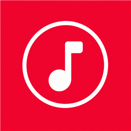</td>
      <td><strong>BetterLyrics</strong></td>
      <td><a href="https://github.com/boidushya">boidushya</a></td>
      <td>Lyrics word by word</td>
    </tr>
    <tr>
      <td align="center"></td>
      <td><strong>Discord</strong></td>
      <td><a href="https://discord.com">Discord Inc.</a></td>
      <td>The activity shown on the profile while a song plays</td>
    </tr>
    <tr>
      <td align="center">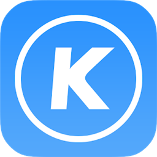</td>
      <td><strong>KuGou</strong></td>
      <td><a href="https://www.kugou.com">KuGou</a></td>
      <td>Lyrics of Asian songs</td>
    </tr>
    <tr>
      <td align="center"></td>
      <td><strong>Last.fm</strong></td>
      <td><a href="https://www.last.fm">Last.fm</a></td>
      <td>Keeps the history of the songs you listen to</td>
    </tr>
    <tr>
      <td align="center"></td>
      <td><strong>LRCLIB</strong></td>
      <td><a href="https://lrclib.net">LRCLIB</a></td>
      <td>Timed lyrics from an open library</td>
    </tr>
    <tr>
      <td align="center">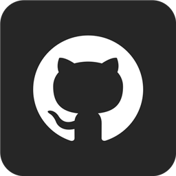</td>
      <td><strong>LyricsPlus</strong></td>
      <td><a href="https://binimum.org">Binimum</a></td>
      <td>Lyrics word by word from the servers of Binimum</td>
    </tr>
    <tr>
      <td align="center"></td>
      <td><strong>Metrolist</strong></td>
      <td><a href="https://github.com/MetrolistGroup/Metrolist">MetrolistGroup</a></td>
      <td>The player, the InnerTube library that finds the audio, the Faraday registry and many ideas</td>
    </tr>
    <tr>
      <td align="center"></td>
      <td><strong>Morphe</strong></td>
      <td><a href="https://github.com/MorpheApp/morphe-patches">MorpheApp</a></td>
      <td>The crossfade and when it works, by VazerOG</td>
    </tr>
    <tr>
      <td align="center"></td>
      <td><strong>MusicBrainz</strong></td>
      <td><a href="https://metabrainz.org">MetaBrainz Foundation</a></td>
      <td>What is known about the artists, such as the birth and the formation</td>
    </tr>
    <tr>
      <td align="center"></td>
      <td><strong>Paxsenix</strong></td>
      <td><a href="https://lyrics.paxsenix.org">Paxsenix</a></td>
      <td>Timed lyrics from its servers</td>
    </tr>
    <tr>
      <td align="center"></td>
      <td><strong>Radios.com.br</strong></td>
      <td><a href="https://www.radios.com.br">Radios.com.br</a></td>
      <td>The stations, their logos and their sound, which the traditional radios read from the site</td>
    </tr>
    <tr>
      <td align="center"></td>
      <td><strong>ReVanced</strong></td>
      <td><a href="https://revanced.app">ReVanced</a></td>
      <td>Inspiration for features such as SponsorBlock</td>
    </tr>
    <tr>
      <td align="center"></td>
      <td><strong>RiMusic &amp; RiPlay</strong></td>
      <td><a href="https://github.com/fast4x">fast4x</a></td>
      <td>Ideas for the downloads and the settings</td>
    </tr>
    <tr>
      <td align="center"></td>
      <td><strong>SimpMusic</strong></td>
      <td><a href="https://github.com/maxrave-dev/SimpMusic">maxrave-dev</a></td>
      <td>Where the notifications and the pages were studied</td>
    </tr>
    <tr>
      <td align="center"></td>
      <td><strong>SponsorBlock</strong></td>
      <td><a href="https://sponsor.ajay.app">Ajay Ramachandran and its community</a></td>
      <td>The marked parts that are skipped, under CC BY-NC-SA 4.0</td>
    </tr>
    <tr>
      <td align="center"></td>
      <td><strong>Weblate</strong></td>
      <td><a href="https://weblate.org">Weblate</a></td>
      <td>The platform where the app is translated, free for open-source projects</td>
    </tr>
    <tr>
      <td align="center"></td>
      <td><strong>YouTube Music</strong></td>
      <td><a href="https://music.youtube.com">Google</a></td>
      <td>The look, the content and the search by sound, which listens to songs, singing and humming</td>
    </tr>
    <tr>
      <td colspan="4" align="center"><em>and more amazing open-source projects</em></td>
    </tr>
  </tbody>
</table>

<h3>Thanks to Google</h3>

<p>Thank you to Google, especially to <strong>YouTube Music</strong>, the service whose music Wavvy brings to a lighter and more fluid app, and to <strong>Gemini</strong>, whose colors inspired the look of Wavvy.<br>
<em>Wavvy is an independent project and is not affiliated with or endorsed by Google.</em></p>

<h3>Development Helpers</h3>

<table>
  <thead>
    <tr>
      <th></th>
      <th align="center">Person</th>
      <th align="center">What it brought</th>
    </tr>
  </thead>
  <tbody>
    <tr>
      <td align="center">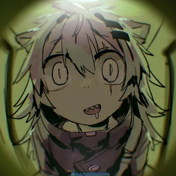</td>
      <td><strong>Noa Inazawa</strong></td>
      <td>Started the project and helped to set its course</td>
    </tr>
    <tr>
      <td align="center"></td>
      <td><strong>Walppxk</strong></td>
      <td>Beta Tester and QA Analyst</td>
    </tr>
  </tbody>
</table>

<h3>Helper Tools</h3>

<table>
  <thead>
    <tr>
      <th></th>
      <th align="center">Tool</th>
      <th align="center">What it brought</th>
    </tr>
  </thead>
  <tbody>
    <tr>
      <td align="center"></td>
      <td><a href="https://claude.com/claude-code"><strong>Claude Code</strong></a></td>
      <td>Development assistant and Tech Lead</td>
    </tr>
    <tr>
      <td align="center"></td>
      <td><a href="https://notebooklm.google.com"><strong>Gemini (NotebookLM)</strong></a></td>
      <td>Inspiration for the look and the identity of the app</td>
    </tr>
  </tbody>
</table>

<h3>Core Technologies</h3>

<table>
  <thead>
    <tr>
      <th align="center">Library/Tool</th>
      <th align="center">Contribution</th>
    </tr>
  </thead>
  <tbody>
    <tr>
      <td><strong>Cloudflare</strong></td>
      <td>Hosts the small relay of Listen Together</td>
    </tr>
    <tr>
      <td><strong>innertubex &amp; Faraday</strong> (MetrolistGroup)</td>
      <td>Finds the audio of each song, the core of the extraction engine, with the player configurations it reads when the audio needs to be deciphered</td>
    </tr>
    <tr>
      <td><strong>Jetpack Compose</strong></td>
      <td>Modern, fluid Android UI framework</td>
    </tr>
    <tr>
      <td><strong>Material Design 3</strong></td>
      <td>Design system and dynamic theming</td>
    </tr>
    <tr>
      <td><strong>Media3 (ExoPlayer)</strong></td>
      <td>Playback in the background, the queue and the media notification</td>
    </tr>
    <tr>
      <td><strong>Reorderable</strong> (Calvin-LL)</td>
      <td>Dragging the songs of the queue</td>
    </tr>
    <tr>
      <td><strong>Room, Ktor, OkHttp & Coil</strong></td>
      <td>Local history, network requests and image loading</td>
    </tr>
    <tr>
      <td><strong>zemer-cipher</strong> (<a href="https://github.com/ZemerTeam/zemer-cipher">ZemerTeam</a>)</td>
      <td>The origin of the player configurations that Faraday is based on</td>
    </tr>
  </tbody>
</table>

<h3>Lyrics Services</h3>

<p>Besides the services above, the lyrics also come from the lyrics and captions of <strong>YouTube Music</strong>, and the translation uses the public endpoint of <strong>Google Translate</strong>, as RiMusic does. Thank you to everyone who keeps them open!</p>

<h3>Thank you to the entire open-source community! Every library and tool that powers this project!</h3>

</div>

---

<!-- LICENSE - License -->
<div align="center">

<h1><a id="license"></a>License</h1>

</div>

Wavvy is licensed under the **GNU General Public License v3.0**, see the [LICENSE](LICENSE) file. Code adapted from other projects keeps its credit and the license it came with, and the SponsorBlock data is under CC BY-NC-SA 4.0.

---

<!-- CONTRIBUTORS - Contributors -->
<div align="center">

<h1><a id="contributors"></a>Contributors</h1>

<h3>This project wouldn't exist without these amazing people, and everyone who helps with code, ideas, tests and translations!</h3>

<a href="https://github.com/Zev-Kaapor/Wavvy/graphs/contributors">
  
</a>

<h5>Want to contribute? <a href="https://github.com/Zev-Kaapor/Wavvy/issues/new">Open an issue</a> with a bug, an idea or a text that is not right!</h5>

</div>

---

<!-- DISCLAIMER - Legal notice -->
<div align="center">

<h1><a id="disclaimer"></a>Disclaimer</h1>

Wavvy is an open-source, non-commercial project developed for educational and personal use. This project is **not affiliated with, funded, authorized, endorsed by, or associated** with YouTube, Google LLC, Last.fm, Discord, or any of their affiliates and subsidiaries.

The radio stations, their names, their logos and their sound belong to their owners, and the lists come from [radios.com.br](https://www.radios.com.br), with which Wavvy has no affiliation or agreement. Wavvy does not host or retransmit any station, it only plays the sound straight from the server of each one. If you own a station or the site and want it to stay out of the app, open an issue and it will be taken out.

All trademarks, service marks, and intellectual property rights referenced in this project belong to their respective owners. Wavvy does not host, store, or distribute any copyrighted media; it functions strictly as a client interface for publicly available content provided via third-party APIs.

</div>

---

<div align="center">

<br/>

**Made with 💙 by [Zev Kaapor](https://github.com/Zev-Kaapor)**

</div>
